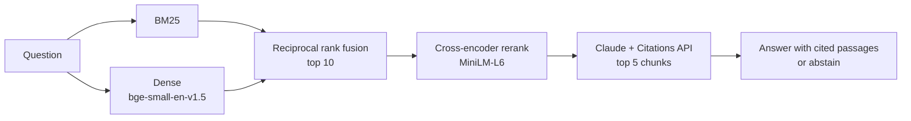

# govuk-rag

Question answering over GOV.UK employment-rights guidance, where every claim in an answer links to the official passage it came from, and the system says so when the guidance doesn't cover a question.

The point of the project is the measurement rather than the chatbot. Every retrieval choice below (chunking, hybrid search, reranking, candidate pool size) was made by running it against a labelled set of 80 questions, and CI fails if retrieval quality regresses.

```
$ govrag search "My till was £50 short. Can my manager take it all out of this week's wages?" -k 3
   2.051  Understanding your pay > Deductions from your pay > If you work in retail - for example shops, restaurants
          https://www.gov.uk/understanding-your-pay/deductions-from-your-pay
  -7.533  Understanding your pay > Deductions from your pay
          https://www.gov.uk/understanding-your-pay/deductions-from-your-pay
  -8.167  Understanding your pay > Pay calculations if you work shifts or get bonuses > Shift or rota work
          https://www.gov.uk/understanding-your-pay/pay-calculations-if-you-work-shifts-or-get-bonuses
```

`govrag ask` sends those passages to Claude and returns a short answer with each claim linked to its passage.

## How it works



1. **Ingest:** 29 GOV.UK guides (160 guide parts, ~42k words) are pulled from the public [Content API](https://content-api.publishing.service.gov.uk/). Each guide part has a stable URL, which serves as both the citation target and the eval label.
2. **Chunk:** parts are split at section headings into ≤160-word windows that overlap by one line. Each chunk is indexed with a breadcrumb header (`Holiday entitlement > Booking time off > When leave can and cannot be taken`), so a short chunk still knows what it's about.
3. **Retrieve:** BM25 and dense embeddings each return candidates, which are fused with reciprocal rank fusion and rescored by a cross-encoder. Everything runs locally on CPU via ONNX ([fastembed](https://github.com/qdrant/fastembed)), with no PyTorch and no vector database. At this corpus size a NumPy dot product takes about 1 ms.
4. **Answer:** the top 5 chunks go to Claude as `document` blocks with [citations](https://platform.claude.com/docs/en/build-with-claude/citations) enabled. Citations come back as structured pointers parsed by the API, not `[1]` markers scraped from text, so a citation can't point at a passage that wasn't retrieved. If the passages don't answer the question, the model replies with a fixed abstention sentence, which the eval checks for.

## Retrieval results

70 answerable questions, scored at guide-part level. Hit@k counts a question as answered if any correct part is in the top k. Latency is per query on an Apple M2 CPU.

| Mode | Hit@1 | Hit@3 | MRR | p50 latency |
|---|---|---|---|---|
| BM25 | 0.486 | 0.814 | 0.657 | 0.7 ms |
| Dense | 0.757 | 0.971 | 0.858 | 5.6 ms |
| Hybrid (RRF) | 0.714 | 0.943 | 0.827 | 6.3 ms |
| Dense + rerank | 0.800 | 0.971 | 0.881 | 171 ms |
| **Hybrid + rerank** (default) | **0.814** | **0.986** | **0.895** | 176 ms |

What the numbers showed:

- **Keyword search struggles with how people actually ask.** The questions are written the way a person would type them ("Can my boss make me use up my holiday over Christmas?"), not in GOV.UK's wording. BM25 gets the right part first less than half the time.
- **Naive hybrid search was worse than dense alone.** Fusing in BM25's weaker ranking pulled hit@1 down from 0.757 to 0.714. Adding BM25 isn't automatically an improvement.
- **The reranker is what makes hybrid worth it.** Once a cross-encoder rescores the fused candidates, hybrid gives the best result on every metric.
- **A pool of 10 candidates is enough.** Reranking 10 candidates instead of 50 gives the same quality at a sixth of the latency (199 ms vs 1,159 ms). Hybrid candidates hold up at small pool sizes better than dense-only ones, which need a pool of 30 to reach the same hit@3. Full sweep: [`evals/results/pool_sweep.md`](evals/results/pool_sweep.md).

One question is worth 0.014 on these metrics, so gaps under about 0.03 are within noise. The pool-size and BM25 findings are well clear of that.

## Answer quality

`evals/run_generation.py` runs the full pipeline on all 80 questions and scores:

| Metric | What it checks |
|---|---|
| Abstention accuracy | Declines the 10 out-of-scope questions (passport renewal, Irish minimum wage, 2027 SSP rates…) and answers the 70 in-scope ones |
| Key-fact recall | Required figures such as `£123.25` or `45 days` appear in the answer (deterministic) |
| Citation precision | Share of cited GOV.UK parts that are correct for the question |
| Correct / fully supported | An LLM judge compares the answer with a reference answer, and lists any claim the retrieved passages don't support |

> Results pending: this step calls the Claude API (about US$3 per full run) and hasn't been run for the published numbers yet. Run `make eval-gen` with an API key to produce `evals/results/generation.json`.

## How the eval set was built

- 70 answerable questions across holiday, sick pay, parental leave, minimum wage, dismissal, redundancy, flexible working, hours, pay deductions, pensions, agency work, tribunals and more, plus 10 that the corpus can't answer. Several of those are deliberately close to the corpus (Universal Credit is *mentioned* but its amounts aren't; Irish minimum wage looks like UK minimum wage).
- Questions are tagged `lookup`, `numeric`, `paraphrase`, `multi-part` or `reasoning` (e.g. "I've been there 5 years. How much redundancy notice am I owed?" needs the 1-week-per-year rule applied), and results are broken down by tag in [`evals/results/retrieval.md`](evals/results/retrieval.md).
- Every reference answer and required figure was checked against the ingested text, which reflects the guidance as of October 2026 (e.g. the 6-month tribunal time limit that applies from 1 October 2026).
- **Label audit:** after the first run, every miss was read by hand. One label was incomplete: q057's answer also appears in the disciplinary-hearings part, so that part was added as gold. The other miss (q053) is a genuine retrieval failure and stays in.
- **Limitations:** one person wrote the questions, they were written while reading the source text, and 70 questions is small. Treat the numbers as a regression baseline for this corpus, not a general benchmark.

## Known failure modes

- **q053**, "I'm a worker, not an employee. Do I get redundancy pay?": retrieval returns the redundancy-pay page, which says pay is for *employees*, rather than the employment-status page listing what workers aren't entitled to. Answering well needs both pages.
- **Vocabulary that never appears in the corpus:** "How much notice do I give when I *quit*" ranks holiday-booking notice above the resignation guide, because GOV.UK says "resign" and "hand in your notice". Query rewriting before retrieval is the obvious next experiment.

## Run it

```bash
python3.12 -m venv .venv && source .venv/bin/activate
pip install -e ".[dev]"

govrag search "can my boss make me take holiday at christmas"   # offline, no key needed
python evals/run_retrieval.py --pool-sweep 10 20 30 50           # offline ablation

export ANTHROPIC_API_KEY=...                                     # or `ant auth login`
govrag ask "How much is statutory sick pay?"
uvicorn govrag.api:app --reload                                  # http://localhost:8000
python evals/run_generation.py --limit 5                         # quick paid smoke run
```

Or with Docker: `docker build -t govuk-rag . && docker run -p 8000:8000 -e ANTHROPIC_API_KEY govuk-rag`.

To refresh the corpus from GOV.UK: `python -m govrag.ingest`. Then re-check the reference answers in `evals/questions.jsonl` for figures that changed (rates change every April).

## CI

Every push runs lint, unit tests and the full retrieval eval. The build fails if hit@3 or MRR for any mode drops more than 0.03 below [`evals/baseline.json`](evals/baseline.json). The embedding and reranker models are cached between runs.

## Layout

```
src/govrag/
  ingest.py     GOV.UK Content API -> data/corpus.jsonl
  chunk.py      section-aware chunking with breadcrumb headers
  retrieve.py   BM25, dense, RRF hybrid, cross-encoder rerank
  generate.py   Claude answers with Citations API, abstention, refusal fallback
  metrics.py    hit@k, MRR, nDCG, tolerant fact matching
  api.py        FastAPI: /search, /ask, and a one-page UI
  cli.py        `govrag search` / `govrag ask`
evals/
  questions.jsonl     80 labelled questions with reference answers
  run_retrieval.py    offline ablation + CI regression gate
  run_generation.py   end-to-end answer evals with an LLM judge
  results/            committed outputs
```

## Data licence

Contains public sector information licensed under the [Open Government Licence v3.0](https://www.nationalarchives.gov.uk/doc/open-government-licence/version/3/). The snapshot in `data/corpus.jsonl` was fetched in October 2026; GOV.UK is the authoritative and current source. This project is not affiliated with GOV.UK, and its answers are not legal advice.

Code is MIT licensed.
